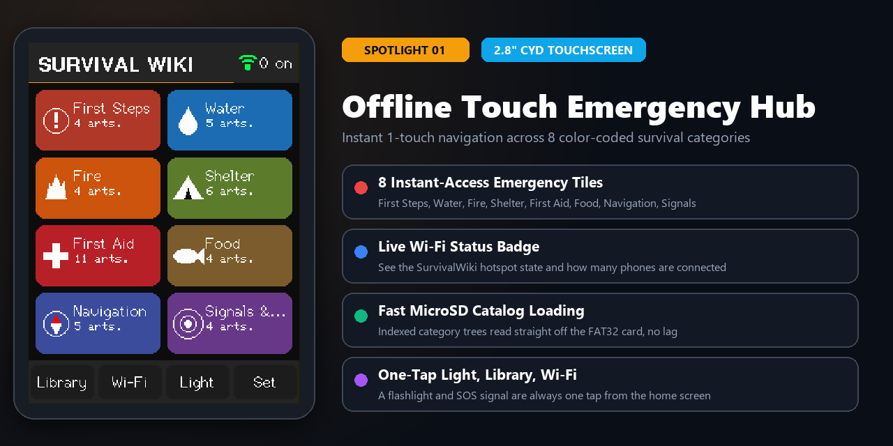
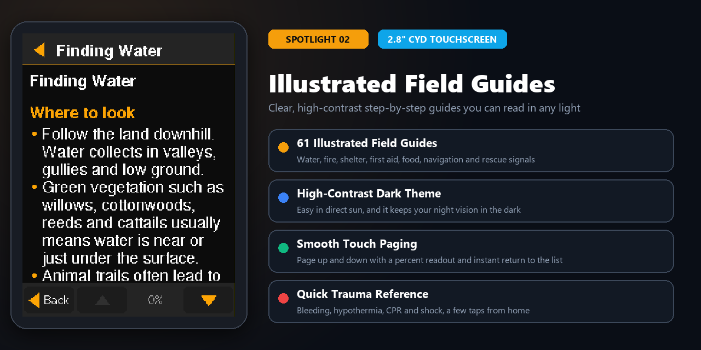
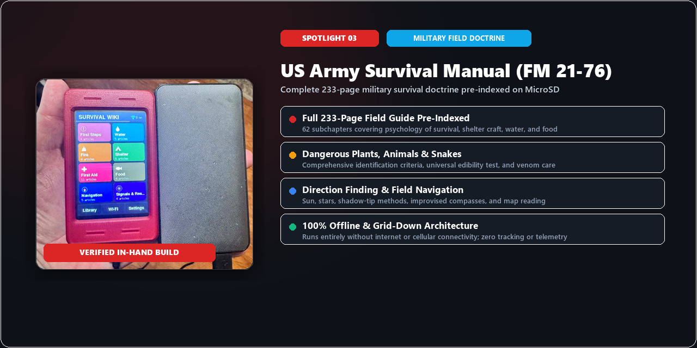
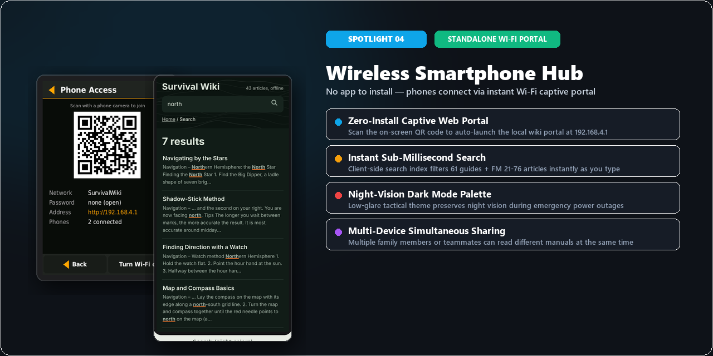
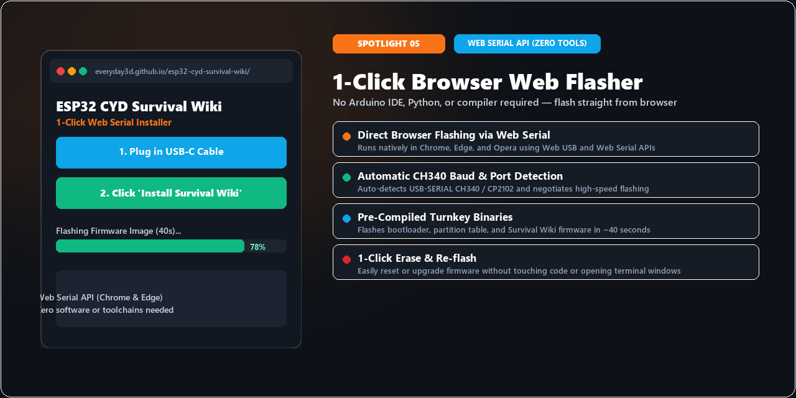
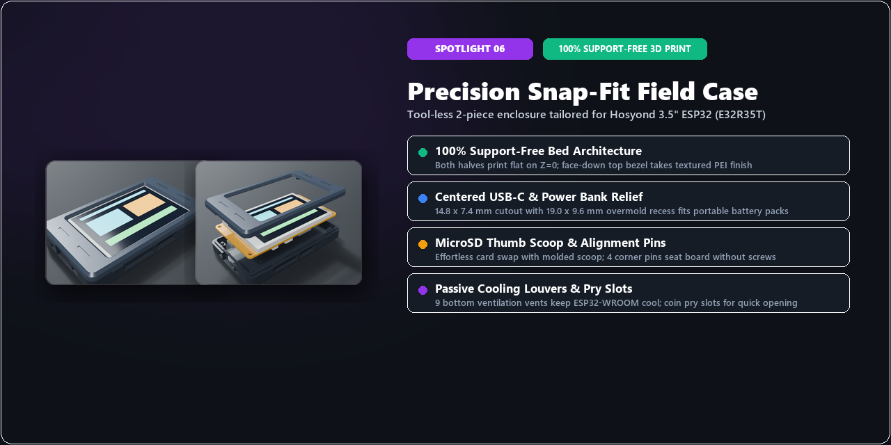
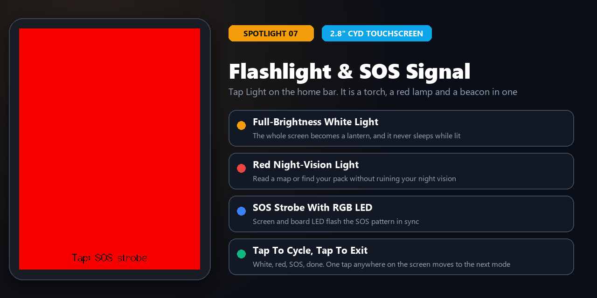
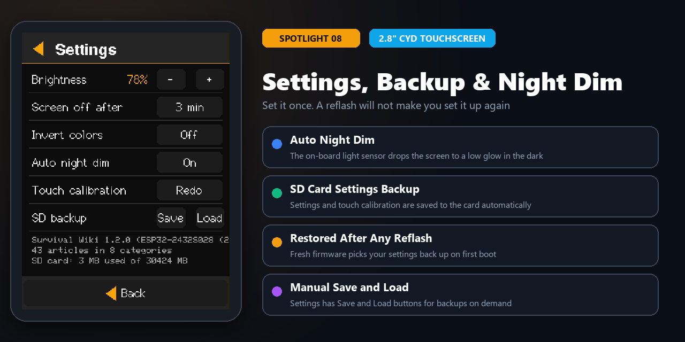

# ESP32 CYD Survival Wiki

[](https://everyday3d.github.io/esp32-cyd-survival-wiki/)
[-blue?style=for-the-badge&logo=bambulab)](case/README.md)
[](LICENSE)

Hey makers! Jimmy here from BoxerDawg 3D.

I built the **ESP32 CYD Survival Wiki** as a 100% offline emergency knowledge base and wireless field guide you can throw in your pack or keep on your shop bench. It turns inexpensive ESP32 touchscreen display boards into dedicated, grid-down survival tools without needing cell towers, internet access, or subscriptions.

Whether you're running the pocket-sized **2.8" Cheap Yellow Display (`ESP32-2432S028R`)** or the larger **3.5" Hosyond Touch Display (`E32R35T`)**, you're completely covered:
- **On the touchscreen:** Tap through 8 emergency categories, 61 illustrated field guides, and the complete 233-page **US Army Survival Manual (FM 21-76)** with smooth paging and crisp diagrams.
- **On your phone or tablet:** Turn on the built-in Wi-Fi hotspot (`SurvivalWiki`) and anyone nearby can connect to read guides, search topics, or download the full survival PDF straight to their device.
- **100% grid-down ready:** Everything runs off a standard FAT32 microSD card and any 5V USB battery bank or phone charger.
- **Support-free 3D printable cases:** Custom 2-piece snap-fit cases modeled in Blender for both screen sizes—they print flat on your build plate and snap together without screws or glue.

---

### 📟 Supported Screens & Hardware

I made sure both popular display boards work seamlessly with the 1-click web flasher, precompiled binaries, and 3D printable cases:

| Screen & Board | Board Model | Resolution & Driver | Ports & Power | 3D Printable Case | Precompiled Firmware |
| :--- | :--- | :--- | :--- | :--- | :--- |
| **3.5" Touch Display** | Hosyond / QDtech `E32R35T` ([Amazon](https://www.amazon.com/dp/B0D93MBWC2)) | $320 \times 480$ (ST7796) | Centered USB-C | [`case/3.5inch/`](case/3.5inch/README.md) (`rev2`) | [`survival-wiki-full.bin`](firmware/bin/survival-wiki-full.bin) |
| **2.8" Cheap Yellow Display (CYD)** | Sunton `ESP32-2432S028R` | $240 \times 320$ (ILI9341) | Micro-USB & Type-C `CYD2USB` | [`case/2.8inch/`](case/2.8inch/README.md) (`rev1`) | [`survival-wiki-28-full.bin`](firmware/bin/survival-wiki-28-full.bin) |

> [!tip] Note on Board Versions
> The 3.5" case is tailored specifically for the Hosyond `E32R35T` with the centered USB-C port. Older Sunton 3.5" boards (`ESP32-3248S035`) with off-center Micro-USB use different pinouts and hole locations, so stick to the `E32R35T` board for the 3.5" print.

```
web-flasher/     1-click browser web flasher (Chrome / Edge Web Serial) + precompiled binaries
firmware/        PlatformIO source code + ready-to-flash bin/ files
sdcard/          MicroSD card files (copy directly to root of a FAT32 card)
case/            3D printable 2-piece snap-fit cases (.3mf, .stl, .blend, and guides)
docs/            GitHub Pages web flasher and documentation assets
screenshots/     UI preview screenshots
```

---

## 🌟 What's Inside

Here is a quick look at the features and tools packed into the Survival Wiki:

### 1. Touchscreen Emergency Dashboard (3.5" & 2.8")
[](docs/screenshots/01_touch_dashboard_spotlight.png)
- **8 Instant Emergency Tiles**: 1-tap access for First Steps, Water, Fire, Shelter, First Aid, Food, Navigation, and Signals & Rescue.
- **Live Status Bar**: Shows Wi-Fi hotspot state, connected devices, battery voltage, and microSD status.
- **Fast Card Reading**: Instant category navigation reads guides directly off your microSD card without lag.
- **Easy Bottom Bar**: Jump between the guide reader, Wi-Fi hotspot toggle, and settings with one touch.

### 2. Illustrated Field Guides & Clear Diagrams
[](docs/screenshots/02_field_guide_reader_spotlight.png)
- **61 Illustrated Guides**: Step-by-step visuals for water filtration, solar stills, traps, splints, and emergency shelters.
- **High-Contrast Dark Theme**: Easy to read in direct sunlight, and preserves your night vision in the dark.
- **Smooth Touch Paging**: Clean touch paging with percentage progress, fast-jump controls, and instant return to the index.
- **Quick Trauma Reference**: Fast-access medical guides for severe bleeding, hypothermia, CPR, and shock.

### 3. Complete US Army Survival Manual (FM 21-76)
[](docs/screenshots/03_us_army_survival_manual_spotlight.png)
- **Full Field Manual**: Complete 233-page survival manual split into 62 easy-reading chapters on your microSD card.
- **Core Field Skills**: Covers survival psychology, kits, finding water, and building fires in tough conditions.
- **Plants & Wildlife**: Plant identification guides, universal edibility testing steps, and snake bite treatment.
- **100% Offline**: Zero cell service, Wi-Fi, or satellite connection needed.

### 4. Offline Wi-Fi Hotspot for Phones & Tablets
[](docs/screenshots/04_wifi_portal_search_spotlight.png)
- **No Apps Required**: Scan the on-screen QR code with your phone or tablet to join the `SurvivalWiki` hotspot.
- **Fast Offline Search**: Search all 61 guides and FM 21-76 chapters right from your phone's browser.
- **Night-Vision Theme**: Gentle red/dark theme won't ruin night vision during power outages.
- **Share with Friends**: Up to 8 phones or tablets can read different manuals at the same time.

### 5. 1-Click Browser Web Flasher (Now with Dual 3.5" & 2.8" Support)
[](docs/screenshots/05_web_serial_flasher_spotlight.png)
- **Zero Software or Drivers**: Flash the full firmware directly from Chrome or Edge using USB Web Serial in about 40 seconds.
- **Hardware Target Selector**: Pick your board with 1 click before flashing—instantly switches between **3.5" Hosyond (`E32R35T`)** and the newly added **2.8" Cheap Yellow Display (`ESP32-2432S028R`)**.
- **Automatic USB Detection**: Plugs straight into common CH340 and CP2102 USB serial chips without manual baud rate or port setup.
- **Precompiled Unified Binaries**: Automatically flashes the bootloader, partition table, and full Survival Wiki image cleanly at offset `0x0`.
- **Clean Install Option**: Tick **Erase Device** when prompted. It's the safest choice every time, and it fixes most touch and calibration problems after an update.

### 6. Support-Free Snap-Fit 3D Cases
[](docs/screenshots/06_snap_fit_case_spotlight.png)
- **100% Support-Free**: Both halves print flat on your build plate. The top bezel prints face-down to pick up your textured PEI sheet.
- **Flush USB Cutouts**: Clean cable access for standard USB-C cables, right-angle adapters, and power banks.
- **Quick-Eject MicroSD Scoop**: Built-in thumb scoop makes swapping microSD cards effortless.
- **Built-in Cooling Vents**: Angled rear louvers keep the ESP32 cool during extended Wi-Fi hotspot use.

### 7. New in 1.2.0 (2.8" CYD firmware)
[](docs/screenshots/07_flashlight_sos_spotlight.png)
[](docs/screenshots/08_settings_backup_spotlight.png)

These landed in the 2.8" build first. The 3.5" build gets them in a later update.
- **Flashlight & SOS Mode**: Tap **Light** on the home bar. Tap the screen to cycle a full-brightness white light, a red light that keeps your night vision, and a flashing SOS signal (the board's RGB LED flashes along with it). One more tap exits. The screen never sleeps while the light is on.
- **Auto Night Dim**: The CYD has a light sensor on the back. Turn on **Auto night dim** in Settings and the screen drops to a low glow in a dark room, then comes back up when the lights do.
- **Settings Backup on the SD Card**: Brightness, sleep timeout, invert colors, Wi-Fi state, auto night dim, and your touch calibration are saved to the SD card automatically. Reflash the board and everything is restored on first boot, with no re-calibrating. **Settings → SD backup** has manual **Save** and **Load** buttons too.
- **Touch That Works on More Boards**: Touch presses are now detected by reading pressure from the touch chip, so it works on clone boards that don't wire up the touch interrupt pin. The calibration screen is easier too: three markers set well in from the screen edges, with a retry if the taps don't register.
- **A Hidden Surprise for Dog People**: There's an easter egg tucked in the home screen. Copy the latest `sdcard/` files to your card, and keep poking at the title.

---

## ⚡ Quick Start in 3 Steps

### 1. Flash the Firmware (1-Click in Browser)
> [!tip] 1-Click Web Flasher — Zero Tools or Drivers Needed
> 1. Open Chrome or Edge and head over to the **[ESP32 CYD Survival Wiki Web Flasher](https://everyday3d.github.io/esp32-cyd-survival-wiki/)** (or open `web-flasher/index.html` locally).
> 2. Plug your display board into your computer with a good USB data cable.
> 3. Select your hardware target at the top of the flasher:
>    - **3.5" Display (Hosyond E32R35T)**: $320 \times 480$ ST7796 with centered USB-C.
>    - **2.8" Display (Classic CYD)**: $240 \times 320$ ILI9341 (`ESP32-2432S028R`).
> 4. Click **Connect / Install**, pick your serial COM port (`USB-SERIAL CH340` or `CP2102`), tick **Erase Device** (recommended every time), and let Web Serial write the full unified image in ~40 seconds!
>    - *If connection fails:* Hold down the **BOOT** button on the side of the board, click Connect, then release BOOT once connected.

*Alternative manual method:* Flash ready-to-flash unified binaries at offset `0x0` via [esptool-js](https://espressif.github.io/esptool-js/) or CLI `esptool.py`:
- **3.5" Hosyond Board:** [`firmware/bin/survival-wiki-full.bin`](firmware/bin/survival-wiki-full.bin)
- **2.8" Classic CYD Board:** [`firmware/bin/survival-wiki-28-full.bin`](firmware/bin/survival-wiki-28-full.bin)

---

### 2. Prepare the MicroSD Card
1. Format a microSD card as **FAT32** (cards up to 32GB work out-of-the-box; for 64GB+, format with FAT32 via Rufus/GUIFormat).
2. Copy **everything inside** the `sdcard/` folder directly to the **root** of your microSD card:
   ```
   / (microSD root)
   ├── config.txt
   ├── wiki/
   │   ├── categories.tsv
   │   ├── catalog.tsv
   │   ├── search.json.gz
   │   ├── articles/
   │   └── img/
   ├── library/
   │   ├── catalog.tsv
   │   ├── field-guide/       # All articles compiled into single book
   │   └── fm21-76/           # US Army Survival Manual (FM 21-76, 62 parts + PDF)
   └── web/
       ├── index.html
       └── index.html.gz
   ```
3. Insert the card into the board's TF card slot.

---

### 3. Power On & Calibrate Touch
1. Power the board from any USB-C phone charger or power bank.
2. On first boot, the board prompts for **touchscreen calibration**: tap each marker as it appears (using a fingernail, pen tip, or stylus for best precision). The 2.8" CYD shows 3 markers, set in from the edges; the 3.5" shows 4 corner arrows. To redo it later, hold the screen during the splash or use **Settings → Touch calibration**.
3. The home screen loads! Tap **Wi-Fi** to display the QR code for phones to scan.

---

## 📱 Connecting Mobile Phones (Captive Portal)
- Join the Wi-Fi network **`SurvivalWiki`** (open network, no password required) or scan the on-screen QR code.
- The portal will pop up automatically. If not, open your browser and navigate to **`http://192.168.4.1`**.
- If your phone prompts "Wi-Fi has no internet access", select **Stay Connected** or **Use as-is**.
- Up to 8 devices can browse simultaneously. Includes dark mode and instant offline fuzzy search.
- To configure network SSID or set a Wi-Fi password: edit `config.txt` on the microSD card.

---

## 🖨️ 3D Printable Snap-Fit Cases (`case/`)
The `case/` directory includes official precision snap-fit enclosures designed in Blender 5.2 for both supported screen sizes:
- **Dedicated 2.8" CYD Enclosure (`case/2.8inch/`):** Tailored for Sunton `ESP32-2432S028R` with universal Micro-USB & Type-C clearance, 4 raised corner support bosses, rear stylus pinholes for BOOT/RESET, and debossed BoxerDawg3D base. Download [`case/2.8inch/ESP32_28_Touch_Case_rev1.3mf`](case/2.8inch/ESP32_28_Touch_Case_rev1.3mf).
- **Dedicated 3.5" CYD Enclosure (`case/3.5inch/`):** Tailored for Hosyond `E32R35T` / `E32N35T` with centered USB-C, 4 tapered M3 corner alignment pins, peripheral headers clearance, and passive cooling louvers. Download [`case/3.5inch/ESP32_35_Touch_Case_rev2.3mf`](case/3.5inch/ESP32_35_Touch_Case_rev2.3mf).
- **100% Support-Free Printing:** Both models print flat on `Z = 0` (Base on its back, Top Bezel face-down on textured PEI). Zero screws, brass inserts, or glue required.
- See the [`case/README.md`](case/README.md) hub and [`case/PRINT_INSTRUCTIONS.md`](case/PRINT_INSTRUCTIONS.md) for full hardware comparison and slicer guidelines.

---

## 🔋 Power Consumption
- Typical power draw is ~1.0–1.5 W with screen on and Wi-Fi active.
- A standard 10,000 mAh battery bank provides over 24 hours of continuous operation.
- **Power saving:** Dim screen brightness or configure sleep timeout in Settings. Tap the screen to wake instantly.

---

## 📝 Customizing & Adding Articles
Articles are standard Markdown documents located in `sdcard/wiki/articles/` with YAML metadata frontmatter:

```markdown
---
title: Purifying Water
category: water
order: 2
tags: boil, bleach, filter
summary: One-line summary displayed in article lists.
---
## Boiling
Bring water to a rolling boil for at least 1 full minute (3 minutes at high altitude).


```

Each article file added to `sdcard/wiki/articles/` is referenced in `sdcard/wiki/catalog.tsv` (Title, Category, Summary, Filename) and displays in its respective category index immediately upon reboot.

---

## 🛠️ Building Firmware from Source (PlatformIO)
Requirements: VS Code with PlatformIO extension (or `pio` CLI).
```bash
cd firmware

# Build and flash for 3.5" Hosyond / QDtech E32R35T:
pio run -e survival-wiki-35 -t upload

# Build and flash for 2.8" Sunton ESP32-2432S028R CYD:
pio run -e survival-wiki-28 -t upload
```

---

## 📜 Board Pinout Reference

### 1. 3.5" Display Module (`Hosyond E32R35T`)
| Function | ESP32 Pin | Details |
|---|---|---|
| **LCD SPI** | SCK 14, MOSI 13, MISO 12 | ST7796U controller ($320 \times 480$), 40MHz SPI |
| **LCD Control** | CS 15, DC 2, Backlight 27 | PWM backlight control |
| **Touch SPI** | CS 33, IRQ 36 | XPT2046 resistive touch (HSPI) |
| **MicroSD SPI** | CS 5, SCK 18, MISO 19, MOSI 23 | VSPI bus |
| **RGB LED** | Red 22, Green 16, Blue 17 | Active LOW |
| **Audio** | Amp Enable 4, DAC 26 | Internal speaker driver |

### 2. 2.8" Display Module (`Sunton ESP32-2432S028R CYD`)
| Function | ESP32 Pin | Details |
|---|---|---|
| **LCD SPI** | SCK 14, MOSI 13, MISO 12 | ILI9341 controller ($240 \times 320$), 40MHz SPI |
| **LCD Control** | CS 15, DC 2, Backlight 21 | PWM backlight control |
| **Touch SPI** | CLK 25, MOSI 32, MISO 39, CS 33, IRQ 36 | XPT2046 resistive touch on its **own** pins (separate from the display bus), read in software. Presses are detected by pressure, so the IRQ pin is optional. |
| **MicroSD SPI** | CS 5, SCK 18, MISO 19, MOSI 23 | VSPI bus |
| **RGB LED** | Red 4, Green 16, Blue 17 | Active LOW |
| **Light Sensor** | GPIO 34 (analog) | Reads about 0 in bright light, higher in the dark. Used by Auto night dim. |
| **Audio** | DAC 26 | Speaker output |

---

## ⚖️ Safety & License
- **Field Reference Notice:** This software is an informational reference guide, not a substitute for professional medical advice, certified wilderness survival training, or emergency services.
- **License:** Open source under the [MIT License](LICENSE).
- **Credits:**
  - Case design by [BoxerDawg 3D](https://boxerdawg3d.com).
  - TFT_eSPI & TJpg_Decoder by Bodmer.
  - QR Code generator by Project Nayuki.
