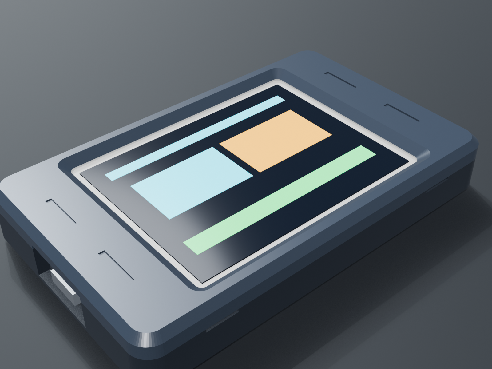
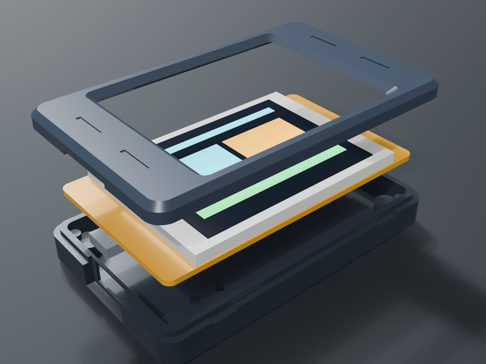
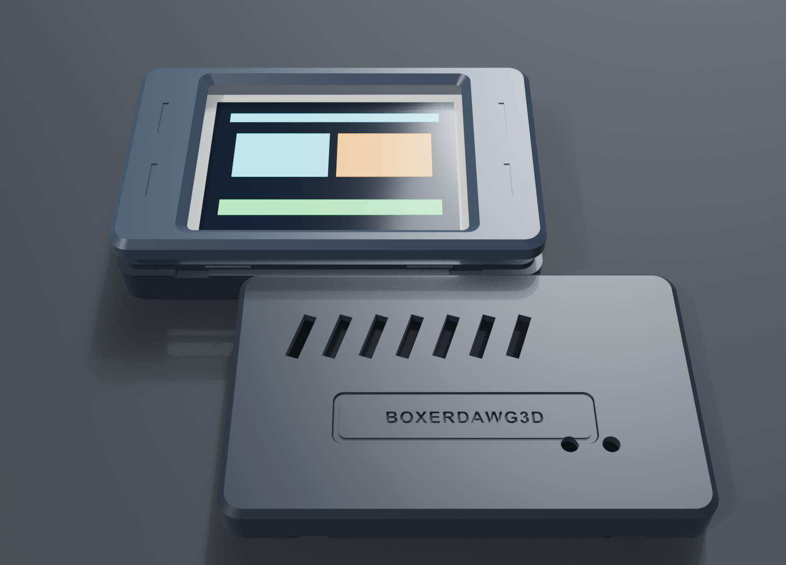
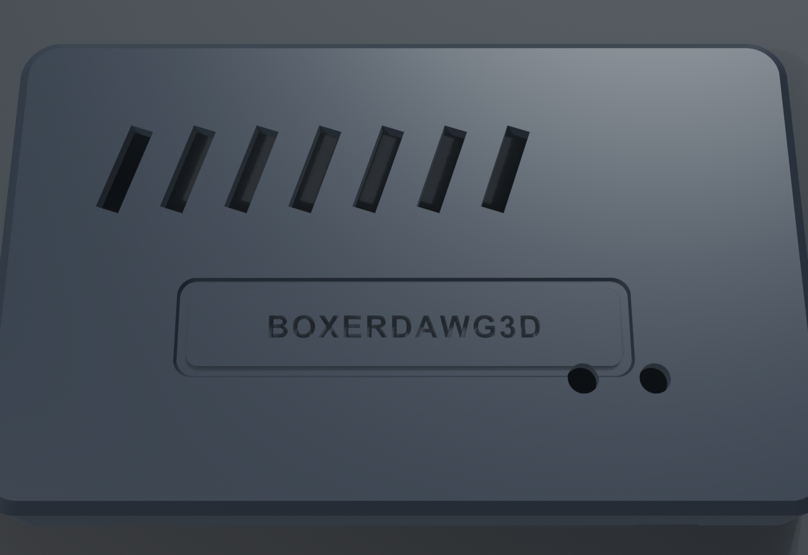

# 2.8" ESP32 Touch CYD Snap-Fit Case (`rev1`)

Hey makers! Jimmy here from BoxerDawg 3D. After releasing our 3.5" snap-fit case, a lot of folks in the community reached out asking for a tailored version for the classic **2.8" Cheap Yellow Display (ESP32-2432S028R)**. 

I sat down in Blender 5.2 and designed this enclosure from the ground up to fit the 2.8" CYD like a glove. Just like the 3.5" case, it's a **100% support-free, 2-piece snap-fit design**—no tiny screws, no brass heat-set inserts, and zero glue required. You drop your board in, click the bezel on, and you're ready to head outdoors or toss it in your gear bag!

---

## 📁 Download Files

- **Ready-to-Print Bambu Studio / OrcaSlicer Project**: [`ESP32_28_Touch_Case_rev1.3mf`](ESP32_28_Touch_Case_rev1.3mf) (also in [`3mf/ESP32_28_Touch_Case_rev1.3mf`](3mf/ESP32_28_Touch_Case_rev1.3mf))
- **Base Shell STL**: [`stl/1_ESP32_28_Case_Base_rev1.stl`](stl/1_ESP32_28_Case_Base_rev1.stl)
- **Top Bezel STL**: [`stl/2_ESP32_28_Case_Top_rev1.stl`](stl/2_ESP32_28_Case_Top_rev1.stl)
- **Assembled Reference STL**: [`stl/ESP32_28_Case_Assembly_rev1.stl`](stl/ESP32_28_Case_Assembly_rev1.stl)
- **Blender 5.2 Source CAD**: [`cad/ESP32_28_Touch_Case_rev1.blend`](cad/ESP32_28_Touch_Case_rev1.blend)

---

## 🔍 Hardware Compatibility

This case is tailored specifically for the **Sunton 2.8" ESP32-2432S028R** module:

| Hardware Spec | 2.8" CYD Module Measurement | Case Feature |
| :--- | :--- | :--- |
| **PCB Dimensions** | 86.00 × 50.00 mm (R = 2.50 mm) | Internal cavity is 87.00 × 51.00 mm with 0.50 mm perimeter float |
| **USB Connectivity** | Micro-USB or USB-C (CYD2USB) | Universal 16.0 × 9.0 mm cutout with 45° chamfered overmold relief |
| **Board Retention** | No corner screw holes | 4 raised corner support bosses (Z = 6.6 mm) with perimeter alignment shoulders |
| **Rear SMD Clearance** | ESP32-WROOM-32 & ch340 chips | 4.60 mm rear floor clearance for cool passive airflow |
| **Buttons** | Rear `BOOT` & `RESET` tactile switches | Precision 3.0 mm rear pinholes for stylus or paperclip access |
| **MicroSD Slot** | Right short edge | Dedicated thumb scoop for effortless card insertion and removal |
| **Speaker Header** | Bottom 2-pin JST connector | Clearance notch on lower wall |
| **Light Sensor (LDR)** | Top left photoresistor | Dedicated light exposure aperture in bezel |

*(Note: If you have the larger Hosyond 3.5" display, check out our [`../3.5inch/`](../3.5inch/README.md) directory instead!)*

---

## 🖨️ Recommended Print Settings

I dialed this in on my Bambu Lab printers (X1-Carbon and A1 Mini), but any modern bed-slinger or CoreXY will print it beautifully:

- **Supports**: **NONE (`0`)** — Every angle and bridge is engineered to print cleanly with zero support material.
- **Orientation**: Both parts sit flat on `Z = 0`:
  - **Base Shell**: Floor facing the bed (so the debossed BoxerDawg3D logo and cooling louvers print crisp against your plate).
  - **Top Bezel**: **Pre-flipped face-down on `Z = 0`**! This lets your front screen bezel inherit the textured PEI finish of your build plate, and the 45° screen chamfer prints without sagging.
- **Layer Height**: 0.20 mm Standard (0.4 mm nozzle).
- **Wall Loops**: 3 walls (ensures crisp, rigid perimeter snaps).
- **Infill**: 15% Gyroid (great strength-to-weight balance).
- **Filament**: PLA, PLA Tough, PLA Matte, or PETG.
- **Print Time**: ~45 minutes total for both pieces on a Bambu Lab printer.

---

## 🛠️ Assembly Instructions

1. **Check Your Clearances**:
   Inspect the 4 corner support bosses in the base shell to make sure your first layer is clean.
2. **Drop in the Board**:
   Angle the USB port into the left port opening, then lower the board flat into the base. The board will seat cleanly on the 4 corner bosses with no rocking.
3. **Snap on the Bezel**:
   Orient the bezel so the light sensor opening matches the LDR at the top left. Press firmly along the long edges until both locking tabs snap into their detents with a solid click.
4. **Taking it Apart**:
   If you ever need to get inside to swap firmware or solder pins, just slip a thumbnail or plastic pry tool into the pry scoop on the bottom edge and pop the bezel off.

---

## 📸 Photo Gallery

### Assembled View

### Exploded Stackup

### Print Bed Layout (Flat on Z=0)

### Bottom Ventilation & Debossed Logo

