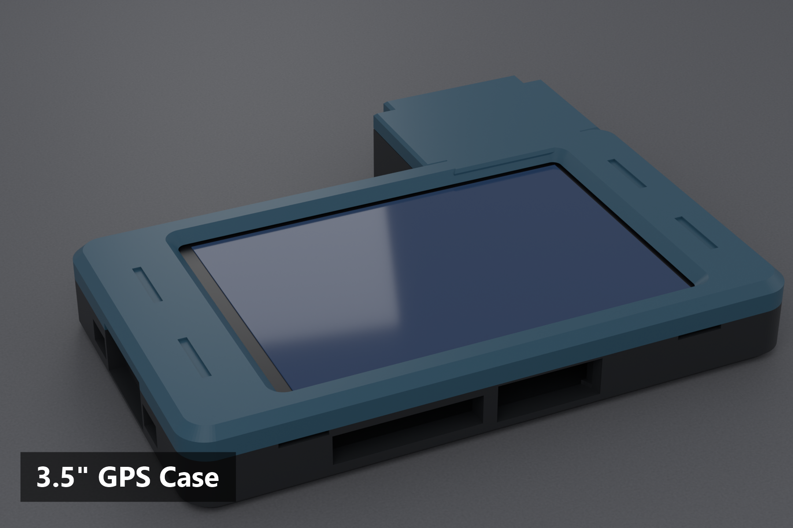

# 3.5" CYD + GPS case (concept, UNTESTED)

**This case has not been printed or fit-tested.** It is a first draft, so expect to adjust it.

It is the 3.5" rev2 case with the same GPS pod as the [2.8" GPS case](../2.8inch-gps/README.md), on the +Y wall (the side with the board's JST sockets): a bay for the Teyleten ATGM336H module (about 16 x 13 mm), a bay for the ceramic antenna (19 x 6 x 6.5 mm) under a thin lid roof, an open cable notch between the bays, and alignment pins. A wire passage lines up with the I2C JST socket (x 25 to 33).

## Not confirmed
- Which 3.5" pin should carry the GPS TX line. The [2.8" wiring how-to](../2.8inch-gps/WIRING.md) (IO27 on CN1) does not apply to this board.
- The pod position, wire passage and lid fit.
- Base and lid touch in places, as in the plain 3.5" rev2 case; the pod adds no new contact in the model.

Both parts fit on one plate (about 230 x 91 mm). Use `ESP32_35_GPS_Case_concept.3mf`, or the two STLs.