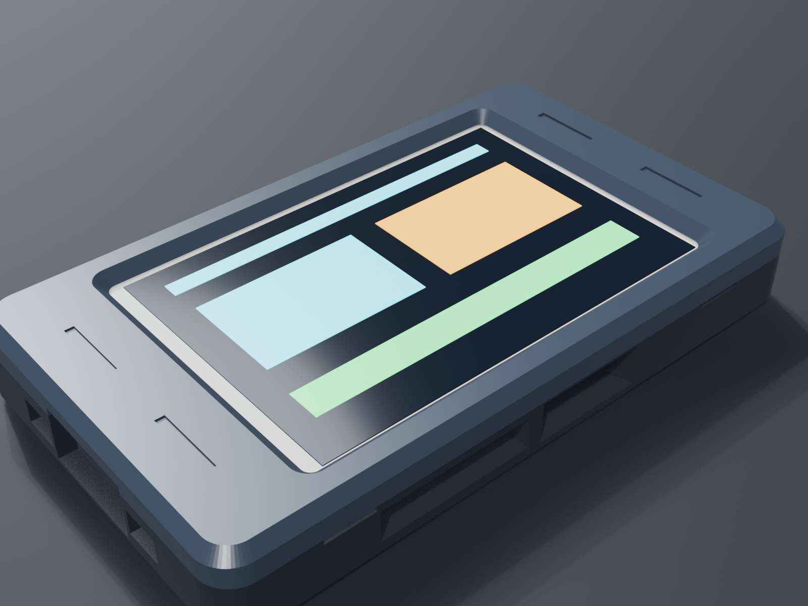
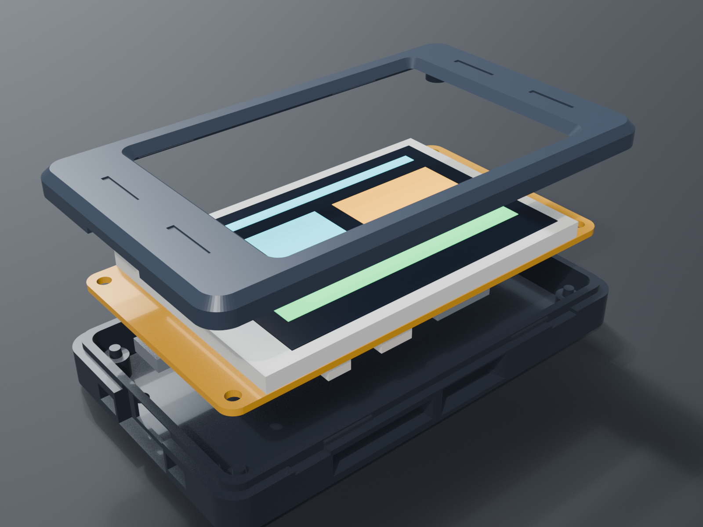
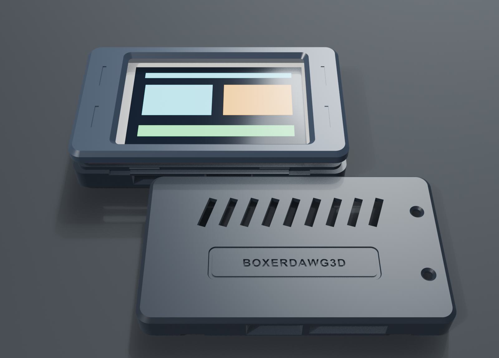
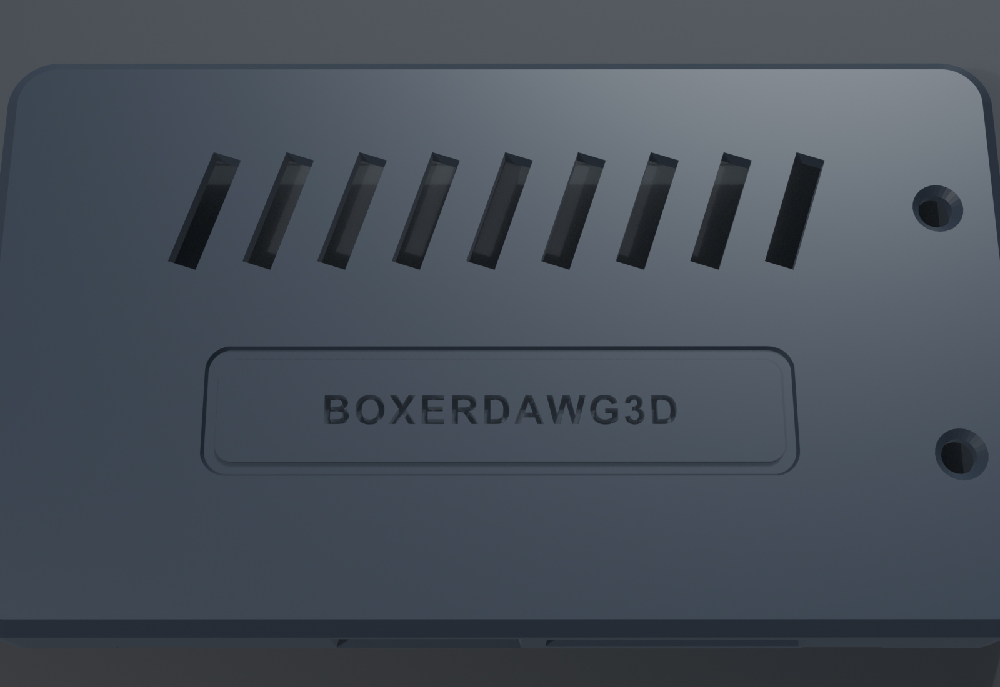

# 3.5" ESP32 Touch CYD Snap-Fit Case (`rev2`)

Hey everyone! Jimmy here from BoxerDawg 3D. This is the official **rev2** precision snap-fit enclosure for the **Hosyond 3.5" 320x480 ESP32-32E Touch Display** (QDtech / LCDWiki `E32R35T` / `E32N35T` — Amazon ASIN [B0D93MBWC2](https://www.amazon.com/dp/B0D93MBWC2)).

I modeled this 2-piece enclosure in Blender 5.2 to eliminate the hassle of hunting down M3 screws and brass threaded inserts. The enclosure prints 100% support-free flat on your build plate and snaps together securely with four internal perimeter detents.

---

## 📁 Download Files

- **Ready-to-Print Bambu Studio / OrcaSlicer Project**: [`ESP32_35_Touch_Case_rev2.3mf`](ESP32_35_Touch_Case_rev2.3mf) (also in [`3mf/ESP32_35_Touch_Case_rev2.3mf`](3mf/ESP32_35_Touch_Case_rev2.3mf))
- **Base Shell STL**: [`stl/1_ESP32_35_Case_Base_rev2.stl`](stl/1_ESP32_35_Case_Base_rev2.stl)
- **Top Bezel STL**: [`stl/2_ESP32_35_Case_Top_rev2.stl`](stl/2_ESP32_35_Case_Top_rev2.stl)
- **Assembled Reference STL**: [`stl/ESP32_35_Case_Assembly_rev2.stl`](stl/ESP32_35_Case_Assembly_rev2.stl)
- **Blender 5.2 Source CAD**: [`cad/ESP32_35_Touch_Case_rev2.blend`](cad/ESP32_35_Touch_Case_rev2.blend)

---

## 🔍 Hardware Compatibility

This enclosure is engineered for the **Hosyond 3.5" ESP32-32E (E32R35T / E32N35T)**:

| Hardware Spec | 3.5" CYD Module Measurement | Case Feature |
| :--- | :--- | :--- |
| **PCB Dimensions** | 101.50 × 55.50 mm (R = 3.50 mm) | Internal cavity is 102.60 × 56.60 mm with 0.55 mm perimeter float |
| **Board Retention** | 4 corner M3 mounting holes | 4 precision tapered alignment pins molded directly into the base |
| **USB Connectivity** | Centered USB-C port (`Y = 0.00 mm`) | Wide USB-C cutout with chamfered cable overmold relief |
| **MicroSD Slot** | Bottom long edge | Dedicated thumb scoop for effortless card access |
| **Buttons** | Side and bottom `BOOT` & `RESET` | Molded button access notches |
| **Expansion Headers** | 6× JST-1.25 mm peripheral connectors | Full internal clearance for optional sensors and wiring |

*(Note: Older Sunton `ESP32-3248S035` boards with off-center Micro-USB ports and M2 holes will not fit this enclosure. If you have the smaller 2.8" CYD, check out our [`../2.8inch/`](../2.8inch/README.md) directory!)*

---

## 🖨️ Recommended Print Settings

- **Supports**: **NONE (`0`)** — 100% support-free design.
- **Orientation**: Both parts sit flat on `Z = 0`:
  - **Base Shell**: Floor-down with cooling louvers facing the bed.
  - **Top Bezel**: **Face-down on `Z = 0`** to pick up your textured PEI finish and allow the 45° screen chamfer to print cleanly.
- **Layer Height**: 0.20 mm Standard (0.4 mm nozzle).
- **Wall Loops**: 3 walls.
- **Infill**: 15% Gyroid.
- **Filament**: PLA, PLA Tough, PLA Matte, or PETG.
- **Print Time**: ~55 minutes total on a Bambu Lab printer.

---

## 🛠️ Assembly Instructions

1. **Seat the Board**:
   Lower your Hosyond 3.5" module into the base shell with the USB-C port aligned with the left cutout. The 4 corner holes on the PCB will slide right over the tapered alignment pins.
2. **Snap on the Top**:
   Place the top bezel over the display and press down around the perimeter until the locking detents click into place.
3. **Disassembly**:
   Use a coin or fingernail in either of the two pry scoops on the bottom seam to gently release the tabs.

---

## 📸 Photo Gallery

### Assembled View

### Exploded Stackup

### Print Bed Layout (Flat on Z=0)

### Bottom Passive Cooling Louvers

