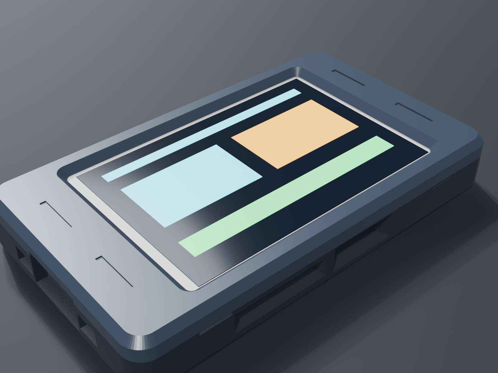
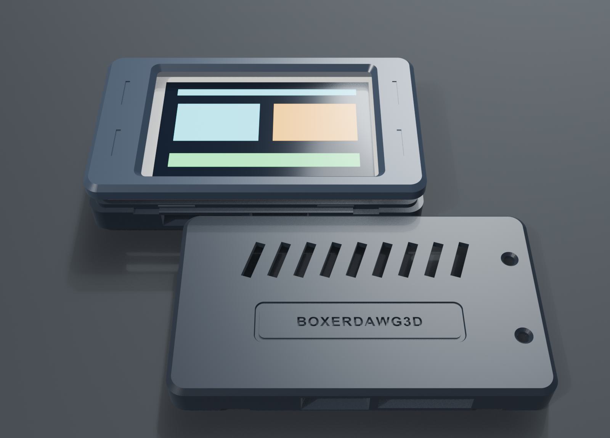
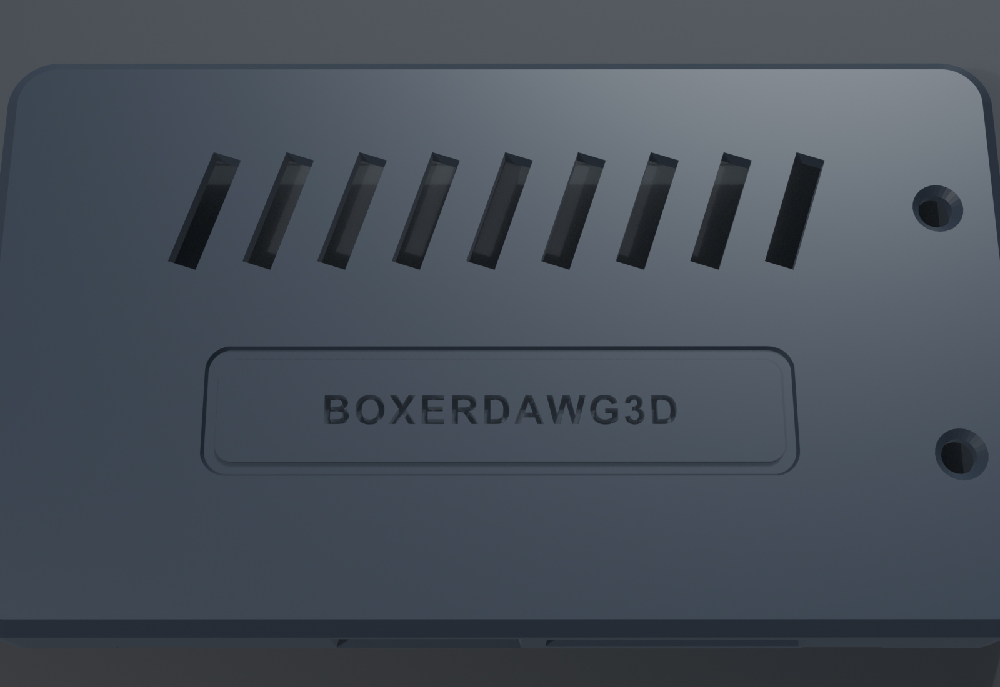

# 3.5" ESP32 Touch CYD Snap-Fit Enclosure


Custom 2-piece screwless snap-fit enclosure tailored for the **Hosyond 3.5" 320x480 ESP32-32E Touchscreen Display Module** (QDtech / LCDWiki model **`E32R35T`** resistive touch / **`E32N35T`** non-touch, Amazon ASIN **[B0D93MBWC2](https://www.amazon.com/dp/B0D93MBWC2)**).

---

## Directory Structure

```
case/
├── 3mf/          Ready-to-print 1-plate project file for Bambu Studio & OrcaSlicer
├── stl/          Individual STL meshes (Base, Top Bezel, and combined Assembly)
├── cad/          Native Blender 5.2 source project (.blend)
└── images/       Assembly diagrams, exploded views, and print orientation renders
```

---

## Download Files

- **Bambu Studio / OrcaSlicer Project**: [`3mf/ESP32_35_Touch_Case_rev2.3mf`](3mf/ESP32_35_Touch_Case_rev2.3mf) (both parts pre-arranged flat on 1 build plate)
- **Base Shell STL**: [`stl/1_ESP32_35_Case_Base_rev2.stl`](stl/1_ESP32_35_Case_Base_rev2.stl)
- **Top Bezel STL**: [`stl/2_ESP32_35_Case_Top_rev2.stl`](stl/2_ESP32_35_Case_Top_rev2.stl)
- **Reference Assembly STL**: [`stl/ESP32_35_Case_Assembly_rev2.stl`](stl/ESP32_35_Case_Assembly_rev2.stl)
- **Blender 5.2 CAD Source**: [`cad/ESP32_35_Touch_Case_rev2.blend`](cad/ESP32_35_Touch_Case_rev2.blend)

---

## Hardware Compatibility

Engineered specifically for the centered USB-C 3.5" CYD board variant:

| Feature | Board Specification (`E32R35T`) | Enclosure Fit |
| :--- | :--- | :--- |
| **Board Footprint** | 101.50 × 55.50 mm (R 3.50 mm corners) | 102.60 × 56.60 mm full-depth cavity (0.55 mm per-side float) |
| **Corner Mounting Holes** | 94.50 × 47.90 mm (4× Ø 3.20 mm M3) | 4× Ø 5.80 mm corner bosses with tapered M3 alignment pins |
| **USB Port** | **Centered Type-C (`Y = 0.00 mm`)** | 14.8 × 7.4 mm window + 19.0 × 9.6 mm cable overmold recess |
| **Buttons** | Side `BOOT` (GPIO 0) & `RESET` (EN) | Side finger access and bottom stylus pinholes |
| **MicroSD Slot** | Bottom edge (`X = +7.50 mm`) | 18.4 mm slot with thumb extraction scoop |
| **Sensors & Headers** | LDR light sensor, speaker, JST ports | Angled bottom louvers & dual top peripheral cutouts |

*(Note: Older Sunton `ESP32-3248S035` boards with off-center Micro-USB ports and M2 holes will not fit this enclosure).*

---

## Recommended Print Settings

- **Supports**: **None (`0`)** — 100% support-free geometry.
- **Orientation**: Both parts print flat on `Z = 0`:
  - **Base Shell**: Floor-down with cooling louvers facing the bed.
  - **Top Bezel**: **Face-down on `Z = 0`** so the front bezel inherits your build plate's textured PEI finish and the 45° screen chamfer prints cleanly without supports.
- **Layer Height**: 0.20 mm Standard (0.4 mm nozzle).
- **Wall Loops**: 3 walls.
- **Infill**: 15% Gyroid.
- **Material**: PLA, PLA Matte, or PETG.
- **Print Time**: ~55 minutes for both parts on a Bambu Lab X1/P1/A1.

---

## Assembly Instructions

1. **Drop in the Board**:
   Lower your Hosyond 3.5" ESP32 module into the base shell with the USB-C port facing the left short wall and the MicroSD card slot facing the bottom thumb scoop. The 4 corner holes on the board will seat directly over the 4 tapered alignment pins.

2. **Snap on the Top Bezel**:
   Align the top bezel over the display and press down firmly around the perimeter until the locking detents click into place.

3. **Disassembly (If Needed)**:
   Use a coin or fingernail in either of the two pry slots along the bottom seam to pop the bezel off without tools.

---

## Visual Gallery

### Studio Render


### Exploded Stackup View


### Print Bed Layout (Flat on Z=0, Zero Supports)


### Bottom Passive Cooling Louvers

