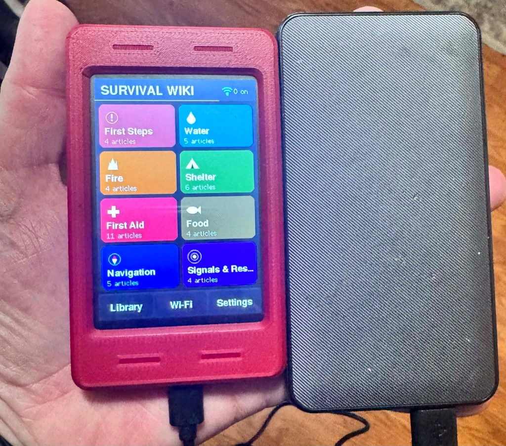

# ESP32 Touch CYD Snap-Fit Enclosures (3.5" & 2.8")



Hey makers! Jimmy here from BoxerDawg 3D. 

Welcome to the 3D printable enclosure hub for the **ESP32 CYD Survival Wiki**! Whether you are building an offline field reference unit on the large **3.5" Hosyond display** or carrying a pocket-sized **2.8" Sunton CYD**, both enclosures are 100% support-free, two-piece snap-fit designs that snap together without screws, glue, or heat-set inserts.

---

## 📂 Choose Your Screen Size

Each screen size has its own dedicated directory with ready-to-slice Bambu Studio / OrcaSlicer `.3mf` files, raw `.stl` meshes, native Blender `.blend` source models, and step-by-step guides:

| Variant | Screen Size | Resolution | Recommended Board | Dedicated Directory |
| :--- | :--- | :--- | :--- | :--- |
| **3.5" Case (`rev2`)** | 3.5 Inch | 320 × 480 | Hosyond ESP32-32E (`E32R35T` / `E32N35T` / [B0D93MBWC2](https://www.amazon.com/dp/B0D93MBWC2)) | **[`3.5inch/`](3.5inch/README.md)** |
| **2.8" Case (`rev1`)** | 2.8 Inch | 240 × 320 | Sunton CYD (`ESP32-2432S028R` Micro-USB & USB-C `CYD2USB`) | **[`2.8inch/`](2.8inch/README.md)** |

---

## 📁 Directory Structure

```
case/
├── 2.8inch/               ⭐ Dedicated 2.8" CYD Case (Sunton ESP32-2432S028R)
│   ├── ESP32_28_Touch_Case_rev1.3mf    Ready-to-print 1-plate 3MF project
│   ├── 3mf/               Bambu Studio & OrcaSlicer project archive
│   ├── stl/               Base, Top, and Assembled STLs
│   ├── cad/               Blender 5.2 procedural CAD source (.blend)
│   ├── images/            Renders, exploded diagrams, and bed layout
│   └── README.md          Full 2.8" hardware specs & assembly guide
│
├── 3.5inch/               ⭐ Dedicated 3.5" CYD Case (Hosyond E32R35T / E32N35T)
│   ├── ESP32_35_Touch_Case_rev2.3mf    Ready-to-print 1-plate 3MF project
│   ├── 3mf/               Bambu Studio & OrcaSlicer project archive
│   ├── stl/               Base, Top, and Assembled STLs
│   ├── cad/               Blender 5.2 procedural CAD source (.blend)
│   ├── images/            Hardware photos, studio renders, and exploded views
│   └── README.md          Full 3.5" hardware specs & assembly guide
│
├── 3mf/                   Shared 3MF directory for quick downloads
│   ├── ESP32_28_Touch_Case_rev1.3mf
│   └── ESP32_35_Touch_Case_rev2.3mf
│
├── PRINT_INSTRUCTIONS.md  Slicer tips, bed leveling, and material guide
└── README.md              This overview & comparison hub
```

---

## 🔍 Hardware Comparison Matrix

| Feature | 3.5" Variant (`E32R35T`) | 2.8" Variant (`ESP32-2432S028R`) |
| :--- | :--- | :--- |
| **PCB Footprint** | 101.50 × 55.50 mm (R = 3.50 mm) | 86.00 × 50.00 mm (R = 2.50 mm) |
| **Cavity Dimensions** | 102.60 × 56.60 mm | 87.00 × 51.00 mm |
| **Board Retention** | 4× M3 tapered alignment pins | 4 corner support bosses + perimeter alignment shoulders |
| **USB Port Cutout** | Centered Type-C (`Y = 0.00 mm`) | Universal Micro-USB & Type-C cutout with overmold relief |
| **Buttons** | Side and bottom `BOOT` & `RESET` | Rear stylus access pinholes for `BOOT` & `RESET` |
| **MicroSD Slot** | Bottom edge with thumb scoop | Right short edge with thumb scoop |
| **Floor Clearance** | 4.80 mm rear clearance | 4.60 mm rear clearance for cool passive airflow |

---

## 🖨️ Universal Print Settings (Both Models)

- **Supports**: **NONE (`0`)** — 100% support-free geometry.
- **Orientation**: Both models print flat on `Z = 0`:
  - **Base Shell**: Floor-down with cooling louvers facing the bed.
  - **Top Bezel**: **Face-down on `Z = 0`** so the front bezel inherits your build plate's textured PEI finish and the 45° screen chamfer prints cleanly without sagging.
- **Layer Height**: 0.20 mm Standard (0.4 mm nozzle).
- **Wall Loops**: 3 walls (creates stiff, reliable snap tabs).
- **Infill**: 15% Gyroid.
- **Material**: PLA, PLA Tough, PLA Matte, or PETG.
- **Print Time**: ~45–55 minutes total on Bambu Lab X1/P1/A1 printers.

See [`PRINT_INSTRUCTIONS.md`](PRINT_INSTRUCTIONS.md) for full slicer notes and troubleshooting!
